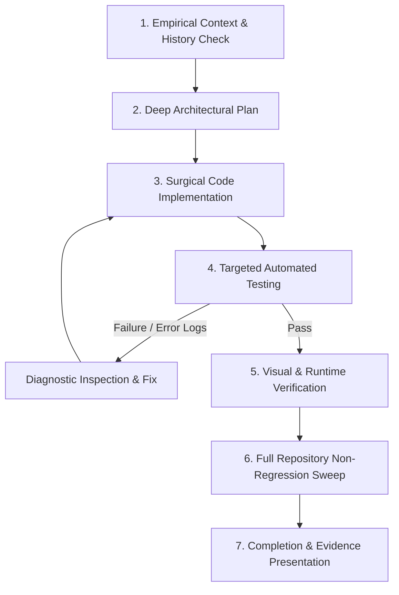

# Closed-Loop Workflow Guide for Autonomous Coding Agents

This guide documents the **Empirical Closed-Loop Workflow** for software engineering agents and LLM models. It serves as a normative protocol to prevent "blind coding" (editing files without deep context, validation, or empirical verification).

---

## Core Philosophy

> **Never declare success without concrete, empirical evidence.**  
> Editing a file is an hypothesis, not a completion. A task is only complete when underlying invariants are verified via code execution, targeted tests, visual rendering, and regression suites.

---

## Workflow Diagram

---

## The 6-Step Protocol

### Step 1: Empirical Research & History Check
Before modifying any line of code:
- **Inspect Source Files:** Read the complete file and surrounding modules using file viewing tools. Never assume function signatures, layouts, or variable names.
- **Trace Commit History:** Check `git log` and `git diff` to understand why current code was written and what past iterations attempted.
- **Identify Invariants:** Understand layout rules, sizing constraints, theme contracts, and API surfaces.

### Step 2: Deep Architectural Planning
Formulate a complete technical specification before writing code:
- Document exact UI layouts (row structures, alignments, spacing, padding, borders).
- Define invariants (e.g., zero height jump on focus, no horizontal scroll, auto-growing textboxes).
- Map out state transitions (dull/inactive vs. vibrant/active, focus changes, editor hosting).

### Step 3: Surgical Implementation
- Modify code cleanly, respecting established conventions and existing design systems.
- Maintain backwards compatibility for existing tests and public methods.
- Ensure all styled elements use explicit, constant units (e.g., constant 1px borders across active/inactive states to guarantee stable dimensions).

### Step 4: Targeted Automated Testing
- Immediately write or update unit tests covering all new requirements (layout, structure, vertical growth, scrollbar policies, size stability).
- Run tests via shell commands (`pytest`) and read the exact output.
- **Log Inspection & Diagnosis:** If a test fails, read the traceback line-by-line. Identify the root cause (e.g., missing font styles, unhandled layout margins) and fix the underlying contract—never mask errors or alter assertions artificially.

### Step 5: Visual & Runtime Verification
For UI components:
- Render offscreen snapshots or visual artifacts using runtime tools (`grab()`, offscreen Qt rendering, browser subagent, etc.).
- Inspect rendered images to verify visual fidelity against user sketches, design specs, alignment, and color themes.

### Step 6: Full Repository Non-Regression Sweep
- Run the full test suite across the repository to guarantee zero side-effects or regressions in dependent components.

---

## Anti-Patterns to Avoid

| Anti-Pattern | Why It Fails | Correct Protocol |
| :--- | :--- | :--- |
| **Blind Editing** | Modifying code without viewing the source or checking past git commits leads to broken layouts and lost features. | Inspect source files and git history first. |
| **Premature Success Claims** | Saying "Fixed!" right after editing a file. | Run tests and verify output before declaring completion. |
| **Symptom Masking** | Commenting out failing tests or wrapping broken code in silent `try/except`. | Trace root cause from stack traces and fix the contract. |
| **Layout Jumping** | Changing border widths, padding, or document margins between states. | Use identical 1px borders, 0px document margins, and height sync across states. |
