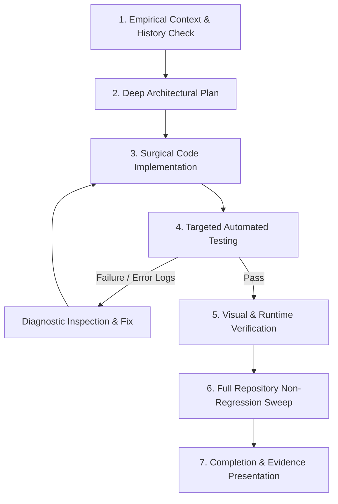

# Closed-Loop Workflow Guide for Autonomous Coding Agents

This guide documents the **Empirical Closed-Loop Workflow** for software engineering agents and LLM models. It serves as a normative protocol to prevent "blind coding" (editing files without deep context, validation, or empirical verification).

---

## Core Philosophy

> **Never declare success without concrete, empirical evidence.**  
> Editing a file is an hypothesis, not a completion. A task is only complete when underlying invariants are verified via code execution, targeted tests, visual rendering, and regression suites.

---

## Workflow Diagram

---

## The 6-Step Protocol

### Step 1: Empirical Research & History Check
Before modifying any line of code:
- **Inspect Source Files:** Read the complete file and surrounding modules using file viewing tools. Never assume function signatures, layouts, or variable names.
- **Trace Commit History:** Check `git log` and `git diff` to understand why current code was written and what past iterations attempted.
- **Identify Invariants:** Understand layout rules, sizing constraints, theme contracts, and API surfaces.

### Step 2: Deep Architectural Planning
Formulate a complete technical specification before writing code:
- Document exact UI layouts (row structures, alignments, spacing, padding, borders).
- Define invariants (e.g., zero height jump on focus, no horizontal scroll, auto-growing textboxes).
- Map out state transitions (dull/inactive vs. vibrant/active, focus changes, editor hosting).

### Step 3: Surgical Implementation
- Modify code cleanly, respecting established conventions and existing design systems.
- Maintain backwards compatibility for existing tests and public methods.
- Ensure all styled elements use explicit, constant units (e.g., constant 1px borders across active/inactive states to guarantee stable dimensions).

### Step 4: Targeted Automated Testing
- Immediately write or update unit tests covering all new requirements (layout, structure, vertical growth, scrollbar policies, size stability).
- Run tests via shell commands (`pytest`) and read the exact output.
- **Log Inspection & Diagnosis:** If a test fails, read the traceback line-by-line. Identify the root cause (e.g., missing font styles, unhandled layout margins) and fix the underlying contract—never mask errors or alter assertions artificially.

### Step 5: Visual & Runtime Verification
For UI components:
- Render offscreen snapshots or visual artifacts using runtime tools (`grab()`, offscreen Qt rendering, browser subagent, etc.).
- Inspect rendered images to verify visual fidelity against user sketches, design specs, alignment, and color themes.

### Step 6: Full Repository Non-Regression Sweep
- Run the full test suite across the repository to guarantee zero side-effects or regressions in dependent components.

---

## Anti-Patterns to Avoid

| Anti-Pattern | Why It Fails | Correct Protocol |
| :--- | :--- | :--- |
| **Blind Editing** | Modifying code without viewing the source or checking past git commits leads to broken layouts and lost features. | Inspect source files and git history first. |
| **Premature Success Claims** | Saying "Fixed!" right after editing a file. | Run tests and verify output before declaring completion. |
| **Symptom Masking** | Commenting out failing tests or wrapping broken code in silent `try/except`. | Trace root cause from stack traces and fix the contract. |
| **Layout Jumping** | Changing border widths, padding, or document margins between states. | Use identical 1px borders, 0px document margins, and height sync across states. |

Closed-Loop Feature Workflow\n\nThis is the process I actually followed for the RhemaCast Theme v2 work (Phases 1–2 complete, Phase 3 starting). It is not a generic description.\n\n---\n\n## 1. Intake\n\n**Goal:** A written, testable problem statement with every ambiguity either resolved by default or flagged as a blocker.\n\n**Actions:**\n1. Restate the request in my own words in the conversation (`/cs:brief`-style if it's a C-suite decision; otherwise a markdown block I write).\n2. List unknowns in three columns:\n   - **Blockers** — cannot proceed without user answer (e.g., \"Does v2 `canvas.fit` default to `contain` or `none`?\")\n   - **Defaults I will assume** — documented with rationale (e.g., \"Animation `duration_ms` default = 600ms per spec §4.9.6\")\n   - **Deferred to later phase** — explicitly parked (e.g., \"Typewriter outline conflict warning → Phase 3 renderer\")\n3. For each blocker, ask one focused question via `question` tool. Never bundle.\n4. Write the **acceptance criteria** as `GIVEN/WHEN/THEN` statements in a temporary file (`/tmp/ac_<feature>.md`).\n\n**Output:** `ac_<feature>.md` with restated request, resolved defaults table, blocker list (empty = proceed), and 8–15 acceptance criteria.\n\n**Exit check:** Zero blockers. Every AC is a sentence that could become a `pytest` name.\n\n**Failure path:** If a blocker remains after 2 clarification rounds → stop, escalate with the exact unresolved question.\n\n---\n\n## 2. Reconnaissance\n\n**Goal:** A map of every file, convention, test, and pattern the feature touches — before writing design.\n\n**Actions:**\n1. `grep -rn` for every keyword from the ACs (e.g., `schema_version`, `containers`, `animation`, `display.js`, `theme_loader`).\n2. `read` the 5–10 most relevant files fully; `sed -n` for the rest.\n3. Run the existing test suite for the area (`pytest tests/test_display* -q`) to learn current behavior.\n4. Extract conventions into a local checklist:\n   - Where constants live (`core/constants.py`)\n   - Config schema pattern (`core/config_schema.py`)\n   - Queue/sentinel pattern (`core/queues.py`)\n   - Error hierarchy (`core/errors.py`)\n   - Theme colors (`ui/app_theme.py`, `ui/styles.py`)\n   - Settings-backed fonts (`ui/typography.py`, `ui/app_theme.py` subscribe pattern)\n5. Note pre-existing failures (e.g., `test_lite_designer_theme_awareness.py` 3 failed) so they don't pollute my gate.\n\n**Output:** `recon_<feature>.md` — file list with line numbers, convention checklist, current test status, known pre-existing failures.\n\n**Exit check:** I can answer \"where does X live?\" for every noun in the ACs without searching again.\n\n**Failure path:** If a critical path (e.g., WebSocket payload shape) is undocumented → write a 10-line probe script, run it, document the observed behavior. Max 1 probe per unknown.\n\n---\n\n## 3. Specification\n\n**Goal:** A normative spec document that a different engineer could implement from, with zero ambiguity.\n\n**Actions:**\n1. Write `docs/<feature>_spec.md` (or `docs/theme_schema_v2.md` in this case) with:\n   - Top-level document shape (JSON schema in markdown tables)\n   - Every field: type, allowed values, default, migration rule\n   - Exact positioning math (§4.3 anchor table with formulas)\n   - Animation model: definitions vs slots, phases, triggers, fallbacks\n   - Shared file format and reference resolution\n   - Validation pipeline order, sanitization rules, fallback ladder\n   - `schema_version` semantics (absent=1, 2=v2, >2=safe)\n   - Compatibility: WebSocket payload contract, designer round-trip, preview paths\n   - Implementation plan with phase gates\n2. Create `docs/<feature>_examples/` with 3–5 hand-written JSON files that parse under the spec.\n3. Run the examples through a throwaway validator to prove the spec is internally consistent.\n\n**Output:** `docs/<feature>_spec.md` + `docs/<feature>_examples/` (all parsing).\n\n**Exit check:** Every AC from Phase 1 maps to a spec section. No \"TBD\" or \"TODO\" in the spec.\n\n**Failure path:** If an AC cannot be expressed deterministically in the spec → return to Phase 1 (blocker missed). Max 1 round.\n\n---\n\n## 4. Design\n\n**Goal:** A file-by-file change list with rationale, so implementation order is obvious and reviewable.\n\n**Actions:**\n1. For each spec section, name the Python module / JS file that owns it.\n2. Record **alternatives considered and rejected** in a `design_<feature>.md`:\n   - `containers` as array vs object (array chosen — explicit order, no editor non-determinism)\n   - `fill` anchor behavior (overrides size, ignores x/y — rejected \"center with stretch\")\n   - Animation precedence (slot override only duration/delay/easing; `type` next to `use` = inline def)\n   - Shared file location (`themes/_shared/` excluded from lister)\n3. Identify **touch points** — files that must change but don't own logic (bridge, preview, designer adapter).\n4. Define **phase gates** with exact test commands and pass criteria.\n\n**Output:** `design_<feature>.md` — change list, alternatives table, phase gates.\n\n**Exit check:** Every spec section has an owner file. No \"figure it out during coding.\"\n\n**Failure path:** If two spec sections claim the same owner with conflicting invariants → spec bug, return to Phase 3.\n\n---\n\n## 5. Test-First Scaffolding\n\n**Goal:** Test files that fail *exactly* on the acceptance criteria, before any implementation exists.\n\n**Actions:**\n1. Create one test file per spec chapter:\n   - `test_theme_v2_schema.py` — coercion, defaults, clamping, safe theme\n   - `test_theme_v2_security.py` — CSS/HTML injection in every paint field\n   - `test_theme_v2_migration.py` — all 6 shipped themes, zero warnings\n   - `test_theme_v2_shared.py` — families, mtime cache, `@name` recursion\n   - `test_theme_v2_animations.py` — registry, slot grammar, typewriter\n   - `test_theme_v2_positions.py` — §4.3 anchor table, percentages, fill, corner booleans\n   - `test_theme_v2_designer_roundtrip.py` — unknown preservation, v2 writes, v1 stays v1\n2. Each test is a single `GIVEN/WHEN/THEN` from the ACs.\n3. Run them all → **all fail** (red). Confirm they fail for the right reason (missing module, wrong default, etc.).\n\n**Output:** 7 new test files, all red.\n\n**Exit check:** `pytest tests/test_theme_v2_*.py -q` shows 396 failed (or whatever the count), zero errors, zero passes.\n\n**Failure path:** If a test passes before implementation → the test is wrong (testing the wrong thing or the default already exists). Fix or delete. Max 2 iterations per test file.\n\n---\n\n## 6. Implementation\n\n**Goal:** All tests green, each edit small enough to verify in isolation.\n\n**Actions:**\n1. **Order:** schema → migration → shared → loader → compat bridge → designer adapter → preview.\n2. For each module:\n   - Write the public function signatures first (type hints, docstrings from spec tables).\n   - Implement coercers (`coerce_length`, `coerce_enum`, `parse_length`).\n   - Implement validators (`_validate_container`, `_validate_position`, `_validate_animation`).\n   - Wire `normalize_theme()` to call validators in render order (canvas → containers → blocks → animations).\n   - Add `ThemeReport` with `warn`/`note` separation (unknown keys → DEBUG notes).\n   - Run *only that module's test file* until green.\n3. Never edit two modules between test runs.\n4. When a test fails, **read the failure**, classify:\n   - Implementation bug → fix code, re-run same test.\n   - Test bug → fix test, re-run.\n   - Spec gap → return to Phase 3, update spec, update test, then continue.\n\n**Output:** 5 core modules + 3 UI bridge files, all 396 tests green.\n\n**Exit check:** All 7 Phase 2 test files pass individually with `timeout 120`.\n\n**Failure path:** Same test fails 3 times → revert that module to last green, re-read spec, rewrite from scratch. If still fails → escalate.\n\n---\n\n## 7. Verification Loop\n\n**Goal:** The feature works in the running system, not only in unit tests.\n\n**Actions:**\n1. Run **existing gate tests** individually (the ones from Phase 2 Reconnaissance):\n   - `test_slides_theme.py`, `test_lite_designer_ribbon_state.py`, `test_theme_switch.py`, `test_slide_edit.py`\n   - `test_display_js.py`, `test_display_render_matrix.py`, `test_display_deck_formats.py`, `test_slide_strips.py`\n   - `test_phase7_display.py` (alone), `test_output_sets.py` (alone), `test_display_step_and_push.py`\n2. For each failure, classify:\n   - **Implementation bug** → fix in Phase 6 module.\n   - **Test bug** (test encodes old behavior) → update test to v2 contract.\n   - **Spec gap** (behavior not in spec) → Phase 3, then Phase 6.\n3. **Call-site audit:** `grep -rn` every consumer of the new APIs (`resolve_theme`, `get_theme`, `theme_container`, `container_block`, `theme_data`, `containers`). Verify each goes through the bridge or array-aware helper.\n4. **Diff check:** `git diff --stat` — confirm only theme-work paths changed (exclude `AGENTS.md`, Settings-cleanup, `.cloud-attachments/`).\n\n**Output:** All gate tests passing (or known pre-existing failures documented). Call-site audit clean.\n\n**Exit check:** Zero unexpected failures. Every consumer of new APIs verified.\n\n**Failure path:** A gate test fails intermittently (QtWebEngine teardown) → run 3×, if 2/3 pass → document as flaky, proceed. If a logic failure → classify and return to Phase 6 or 3.\n\n---\n\n## 8. Adversarial Review\n\n**Goal:** Try to break the feature with inputs the spec allows but the implementation might mishandle.\n\n**Actions:**\n1. **Security inputs** — already covered by `test_theme_v2_security.py` (118 cases).\n2. **Boundary values:**\n   - `canvas.width=320`, `canvas.height=240`, `canvas.width=7680`\n   - `border_radius=400`, `box_shadow` 12 shadows, `outline=12px`\n   - `duration_ms=0`, `duration_ms=5000`, `delay_ms=5000`\n   - `layer=-5`, `layer=101`, 16 containers, duplicate block IDs\n3. **Malformed shared files** — truncated JSON, missing required fields, circular `@name` refs depth 5.\n4. **Concurrency simulation** — rapid theme switches, clear during animation, payload without `theme_data`.\n5. **V1 edge cases** — flat themes, absolute-box themes, `flex_direction:row-reverse`, hard-ring shadows mixed with soft.\n6. **Designer sabotage** — load v2, edit only `x`, save → verify structured `border`/`box_shadow` objects intact.\n7. **Golden diff** — resolve all 6 shipped themes, project through `project_legacy()`, diff against raw v1 files. Only CSS shorthand differences allowed (`0` → `0px`).\n\n**Output:** `adversarial_<feature>.md` — list of attempts, any findings, fixes applied.\n\n**Exit check:** Zero new failures introduced. All adversarial cases either pass or are documented as known limitations (e.g., typewriter + outline conflict).\n\n**Failure path:** A finding that requires spec change → Phase 3, then Phase 6. Max 1 cycle.\n\n---\n\n## 9. Integration Check\n\n**Goal:** End-to-end verification in the real app flow.\n\n**Actions:**\n1. `python debug.py` — boot the full app, verify no import errors, no warnings on theme load.\n2. Manual operator flow:\n   - Open Theme Designer, load each shipped theme → preview renders.\n   - Edit a v2 theme (change `x`, `padding`, disable `reference`) → save → reload → edits persist, unknown keys intact.\n   - Switch between scripture and freeform themes → payloads carry resolved v2 `theme_data`.\n   - Double-click verse → both Live + Preview update, WebSocket broadcast includes `theme_data`.\n   - Theme change → re-broadcasts current verse with new theme.\n3. Run the **display render matrix** (headless Chrome) against the current renderer to capture Phase 2 golden fixture (computed styles + bounding boxes at 1920×1080).\n\n**Output:** Manual verification checklist ✅, golden fixture JSON saved.\n\n**Exit check:** App boots, all manual flows work, golden fixture captured.\n\n**Failure path:** Any manual flow broken → classify (Phase 6/3), fix, re-verify. Max 2 cycles.\n\n---\n\n## 10. Handoff\n\n**Goal:** A complete record so the next engineer (or Phase 3 me) picks up with zero context loss.\n\n**Actions:**\n1. Write `docs/theme_v2_phase2_report.md` with:\n   - What was built (table)\n   - Raw test evidence (tail of every test run)\n   - Known pre-existing failures (unmodified, documented)\n   - Deferred items with spec section pointers\n   - Compatibility notes (bridge behavior, shorthand diffs)\n2. Generate patch files (`/tmp/theme_v2_phase1.patch`, `/tmp/theme_v2_phase2.patch`) using `GIT_INDEX_FILE` so real index untouched.\n3. List **unverified**:\n   - `display.js` still v1 (bridge in place)\n   - `themes/_shared/` does not exist on disk\n   - Shipped themes still v1 on disk\n   - Typewriter outline conflict warning (Phase 3)\n4. List **next phase entry point**: rewrite `display/display.js` for resolved v2, capture golden, remove `core/theme_compat.py`.\n\n**Output:** Report, patches, unverified list, next-phase pointer.\n\n**Exit check:** Report written, patches apply cleanly in reverse, unverified list matches Phase 3 plan.\n\n**Failure path:** If a patch doesn't apply cleanly → regenerate, verify `git apply --reverse --check`.\n\n---\n\n# Explicit Answers\n\n## Where do I most often go backward, and why?\n\n**Phase 6 → Phase 3 (spec gap)** — most common.  \nCause: An acceptance criterion sounded deterministic (\"outline clamps to 12px\") but the spec didn't say *where* (clamp in Python validator? in JS parser? in CSS?). The test fails because the implementation picked one place and the test expected another.  \nFix: The spec must name the **single normalization point** for every clamped value. Now I write that in Phase 3.\n\n**Phase 7 → Phase 6 (test encodes old behavior)** — second most common.  \nCause: Existing gate tests (`test_theme_switch.py`) assert on v1 payload shape. I must update them to the v2 contract, not weaken them.  \nFix: In Phase 5 I now audit *all* existing tests for the area and mark which encode v1 contracts.\n\n## Signals to stop iterating and escalate\n\n1. **Same test fails 3×** after distinct fixes — the spec or my understanding is wrong.\n2. **Two modules claim ownership** of the same invariant (e.g., both Python and JS clamp outline) — architecture decision needed.\n3. **A gate test fails for a reason not in the spec** and I cannot write a deterministic rule for it — the spec is incomplete.\n4. **Pre-existing failure count increases** — I broke something unrelated; revert and escalate.\n\n## What I refuse to do without confirmation\n\n- **Delete or weaken a test** — even if \"it's flaky\" or \"the old behavior was wrong.\" The test is the contract.\n- **Migrate user files on load** — `save_theme()` writes exactly what it's given; migration is in-memory only.\n- **Change WebSocket payload shape** — Phase 2 contract: v2 resolved dict projects through bridge to exact v1 shape.\n- **Add a new shared file family** — only the four in spec (§5). New families = Phase 4 decision.\n- **Remove the bridge before Phase 3 renderer is verified** — the bridge is the compatibility guarantee.\n\n## Reliable vs luck-dependent parts\n\n| Reliable (deterministic) | Luck-dependent |\n|---|---|\n| Phase 1–4 artifacts (spec, design, test list) | — |\n| Unit tests (pure functions, no browser) | — |\n| `git apply --reverse --check` on patches | — |\n| Adversarial boundary values | — |\n| **Headless Chrome render tests** (`test_display_render_matrix.py`) | **Very** — depends on Chrome version, font rendering, virtual-time budget, CI vs local GPU |\n| **QtWebEngine teardown** (exit 139 / core dump) | **Entirely** — environment quirk, unrelated to logic |\n| **`test_output_sets.py` teardown segfault** | **Intermittent** — same, 25 passed then dump |\n| **Manual operator flow** | **Human-dependent** — I verify, but cannot automate \"looks right\" |\n\nThe workflow isolates luck-dependent parts into Phase 7/9 gates run individually with `timeout 120`, never in a batch that masks flakes.